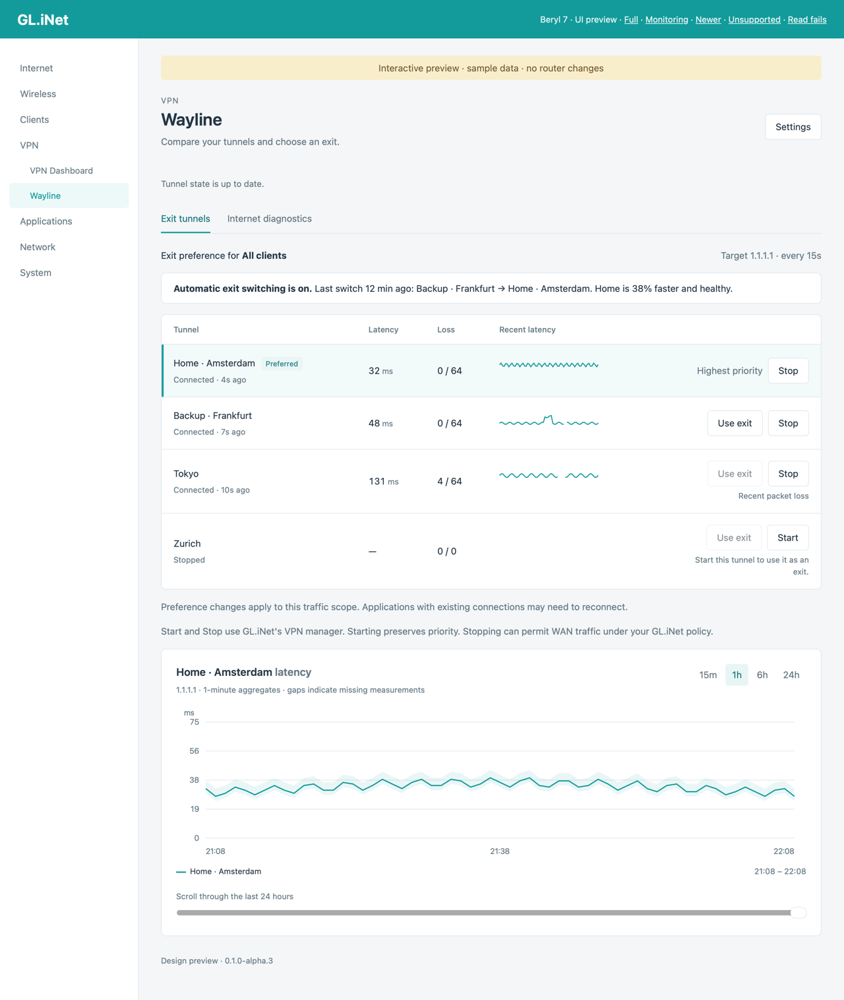
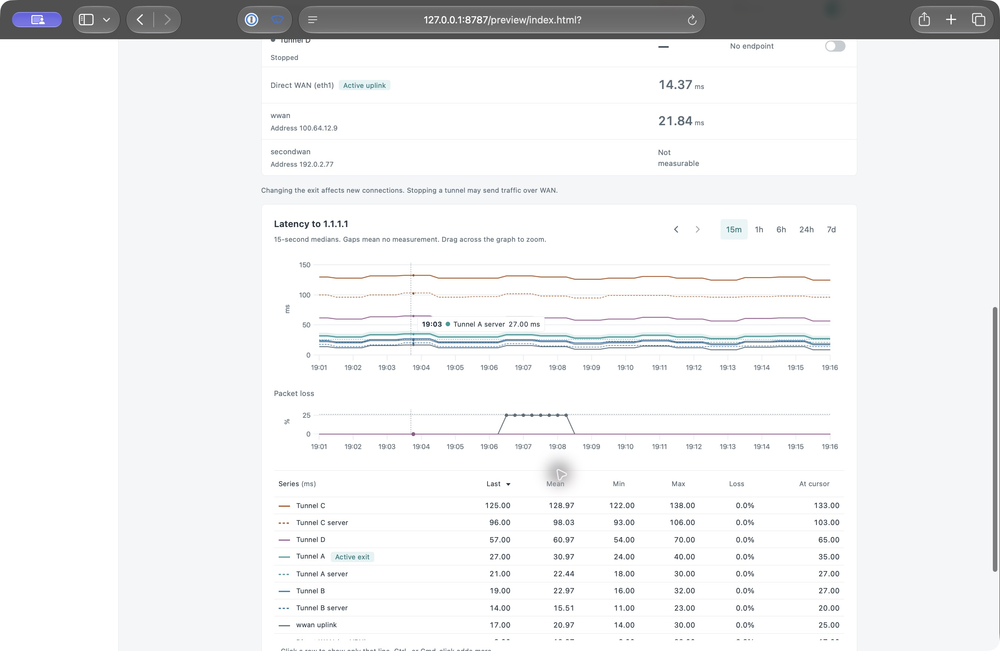

# Wayline

Wayline compares your VPN tunnels on a GL.iNet router. It adds a **VPN → Wayline** page to the admin UI that shows how fast each tunnel is right now, starts and stops tunnels, and picks the tunnel you exit through. It is an experimental alpha.





## Features

- **Tunnel comparison.** Small probes through each tunnel show latency, loss, and path state.
- **Exit selection.** *Use as exit* raises a healthy tunnel to the top of GL.iNet's own priority order. A switch on each row starts or stops the tunnel.
- **Automatic exit switching.** Optional. Moves to a clearly faster healthy tunnel, or away from an unhealthy exit.
- **Host name targets.** Measure up to four extra IP addresses or host names through every tunnel.
- **WAN and endpoint diagnostics.** Optional direct WAN checks, and the route to each WireGuard server.
- **History.** Graphs from 15 minutes to 24 hours, with optional persistent storage.
- **Exit IP.** The page shows the public address each tunnel and the WAN uplink exit from, refreshed every five minutes.
- **Signed updates.** Checks GitHub Releases, including alpha and beta releases, and verifies a signed manifest before installing.

Wayline never changes routes, DNS, or kill switches. It only reorders GL.iNet's own tunnel priority.

## Requirements

- A GL.iNet router with the `aarch64_cortex-a53` architecture, such as the Beryl 7 (GL-MT3600BE).
- Firmware 4.9.0 or newer.
- SSH access to the router for the first install.

## Install

Run this on the router, in an SSH session:

```sh
curl -fsSL https://raw.githubusercontent.com/epk/wayline/main/install.sh | sh
```

The script installs the newest release, prereleases included. Before it installs anything, it checks the signing key fingerprint, the manifest signature, and the package SHA-256 against the signed manifest, and it stops at the first failure.

To pin a version, download `install.sh` and run `WAYLINE_VERSION=0.1.0-alpha.5 sh install.sh`.

Create your tunnels in the factory **VPN** page first. Then open **VPN → Wayline → Settings**, select the tunnels to monitor, and turn monitoring on.

## Update

Run `wayline-ctl update`, or open **VPN → Wayline → Settings** and choose *Check for update*. Every update verifies the signed manifest and the package hash before it installs. Automatic updates are off by default. When on, they check once a day and install the newest signed release, alpha and beta releases included.

## Remove

```sh
opkg remove wayline
```

## Command line

| Command | What it does |
| --- | --- |
| `wayline-ctl help` | List the commands. |
| `wayline-ctl doctor` | Print firmware support, installed files, settings, tunnels, and monitor state. |
| `wayline-ctl update` | Install an available signed update. |
| `wayline-ctl update --check` | Check for a newer release without installing it. |
| `wayline-ctl egress` | Show the public address each tunnel exits from. |

## Troubleshooting

- Run `wayline-ctl doctor` on the router and send its output when you report a problem.
- If the page says the firmware is unsupported, read the reason on the page. A newer Wayline release may add support.
- If *Wayline is unavailable* appears, your session may have expired or is not a root administrator session. Sign in again.

## Development

Development runs on macOS or Linux, on ARM64, with [Nix](https://nixos.org/download). Enter the pinned environment, then run the commands inside it:

```sh
nix run -f nix/bootstrap.nix devenv -- shell
```

- `cargo xtask deps` fetches Cargo and pnpm dependencies.
- `cargo xtask check` runs the formatters, Clippy, unit checks, and linters.
- `cargo xtask build` cross-builds the ARM64 binaries and the UI bundle.
- `cargo xtask package [version]` builds the IPK in `dist/`.
- `cargo xtask preview` serves the UI with sample data.
- `cargo xtask lab` runs the closed-box lab.

The lab starts a minimal Colima VM that uses network namespaces and real WireGuard interfaces to inject delay, loss, and interface failures, then stops the VM afterwards.

## Status

Wayline is an experimental alpha. It is checked in an isolated ARM64 WireGuard lab and has run on a Beryl 7. A full acceptance run on a physical router is still open before a stable release.

## License

MIT. See [LICENSE](LICENSE). Third-party licenses ship inside the package.
