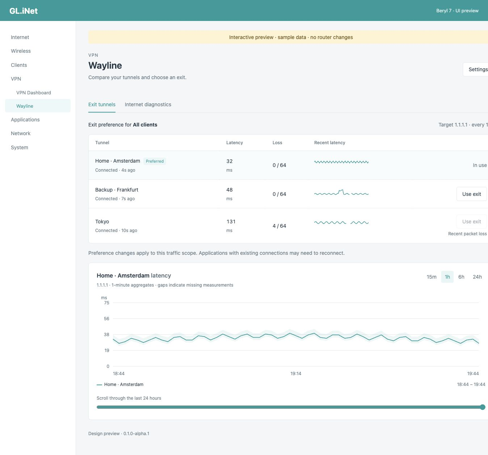
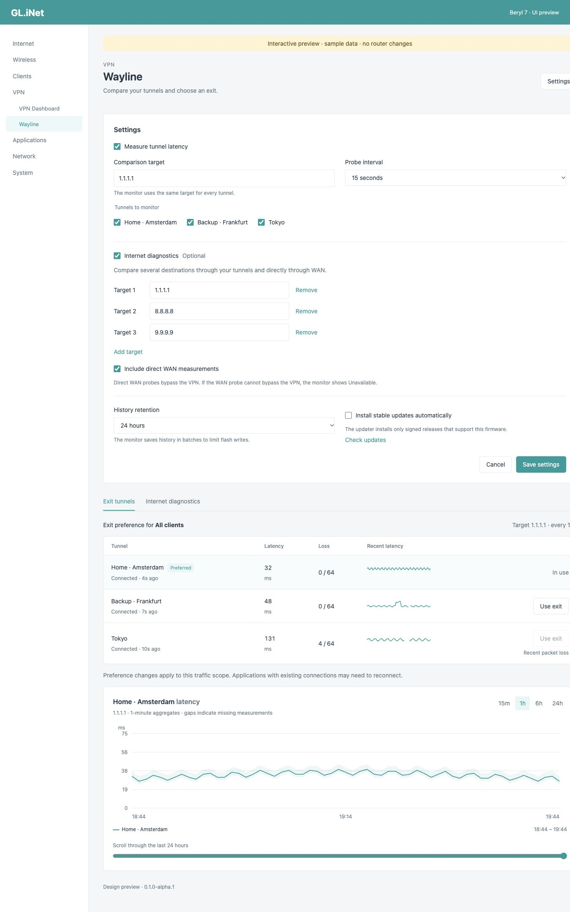
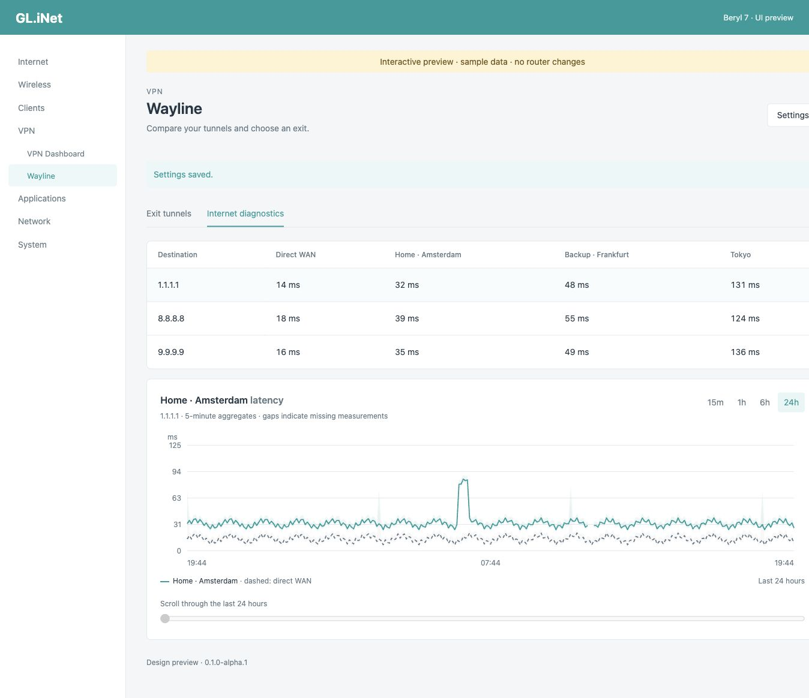

# Wayline

Wayline compares VPN latency in the GL.iNet admin UI.
Choose an active exit, inspect latency graphs, and compare destinations through a tunnel or directly through WAN.

**MVP: experimental alpha.**
The first package targets Beryl 7 (GL-MT3600BE), firmware 4.9.0 release1, and `aarch64_cortex-a53`.
The monitor runs in an isolated ARM64 WireGuard lab.
Physical router installation and native priority changes still need hardware validation.
Other firmware contracts remain disabled.

## Features

- Manual exit selection through GL.iNet's native priority API.
- Recent latency, loss, and path state for up to eight active tunnels.
- Graphs with 15-minute, one-hour, six-hour, and 24-hour ranges.
- Optional destination checks through tunnels and direct WAN.
- Editable targets, including initial values `1.1.1.1`, `8.8.8.8`, and `9.9.9.9`.
- Optional persistent history with an 8 MiB database limit.
- Signed updates from GitHub Releases, with automatic stable updates disabled initially.

All settings appear in **VPN → Wayline**.
Monitoring starts disabled.
Create and connect tunnels in the factory VPN page first.

Wayline changes priority only when the native traffic rules match and the chosen exit has recent healthy measurements.
It does not automatically switch exits.
Different traffic rules, inactive group members, unknown firmware, or uncertain routing prevent selection.

## Install

1. Open the [releases page](https://github.com/epk/wayline/releases).
2. Download the ARM64 IPK, `manifest.json`, `manifest.json.sig`, and `release.pub` from the same release.
3. Transfer these files to `/tmp` on the router.
4. Connect to the router through SSH.
5. Check the signing key fingerprint:

```sh
usign -F -p /tmp/release.pub
```

The expected fingerprint is **e75bc29163d35266**.
Compare it with this repository through an independent connection.

6. Check the manifest signature:

```sh
usign -V -p /tmp/release.pub -m /tmp/manifest.json -x /tmp/manifest.json.sig
```

7. Compare the package size and SHA-256 with its signed manifest entry:

```sh
wc -c /tmp/wayline_0.1.0-alpha.1_aarch64_cortex-a53.ipk
sha256sum /tmp/wayline_0.1.0-alpha.1_aarch64_cortex-a53.ipk
```

8. Install the package:

```sh
opkg update
opkg install /tmp/wayline_0.1.0-alpha.1_aarch64_cortex-a53.ipk
```

9. Refresh the admin UI.
10. Open **VPN → Wayline → Settings**.
11. Select the connected tunnels.
12. Enable monitoring.

Installation uses SSH because the factory plugin catalog does not list this package.
Product configuration uses the UI.
Do not install a Cortex-A53 package on another architecture.

To remove Wayline:

```sh
opkg remove wayline
```

Removal stops Wayline and removes its startup and scheduler entries.
The package manager can retain settings and history.
Wayline does not restore a previous native tunnel order.

## Updates

The UI can check and install signed stable updates.
Automatic updates require explicit opt-in.
The automatic check runs at most once daily.
It checks the firmware contract, architecture, signed manifest, package identity, size, and digest before installation.

The alpha release does not count as a stable update.
Update checks can report no stable release until the first stable release exists.
A failed or uncertain installation requires manual review.
An update cannot guarantee recovery from power loss.

## Development

Install Nix with flakes enabled.
Enter the pinned devenv environment:

```sh
nix run -f nix/bootstrap.nix devenv -- shell
```

Run these commands inside that environment:

```sh
cargo xtask deps
cargo xtask check
cargo xtask build
cargo xtask package
cargo xtask preview
```

Open `http://127.0.0.1:8787/preview/index.html` for the sample UI.
The native bundle contains neither the sample adapter nor another Vue runtime.

Development runs on bare metal macOS ARM64 or Linux ARM64.
The ARM64 Linux monitor uses Monoio with legacy epoll, one thread, and eight concurrent attempts.
Release builds use Cortex-A53 instructions, full LTO, one codegen unit, size optimization, and abort-on-panic.
Overflow checks remain enabled.

`cargo xtask check` enforces Clippy all, pedantic, and nursery rules with warnings denied.
It also checks Rust formatting, JavaScript, Vue, Lua, Nix, Actions, and required OpenWrt hooks.
Project tooling uses Rust.
Nix, Cargo, and pnpm inputs have lock files.

## Closed-box checks

```sh
cargo xtask lab
```

On macOS, this command starts a dedicated minimal Colima VM and stops it after the run.
It mounts the locked Nix tools into the VM.
It uses network namespaces and real WireGuard interfaces.
It creates no containers and requires no guest package installation.
Builds remain on macOS.

The lab injects delay, total loss, blackhole routes, wrong exits, protocol-specific blocks, and interface failures.
It also checks crash recovery and the maximum timeout schedule.
Reports include binary hashes and measured CPU, memory, thread, and descriptor use.

See [validation](docs/validation.md), [safety](docs/safety.md), [architecture](docs/architecture.md), and [release operations](docs/updates.md).
The [research](docs/research.md) and [firmware evidence](docs/firmware-evidence.md) record the upstream sources and target contract.

## Screenshots

These screenshots use labeled sample data.






