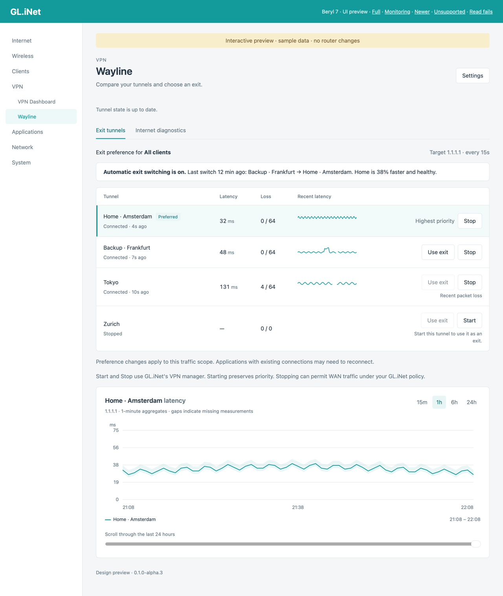
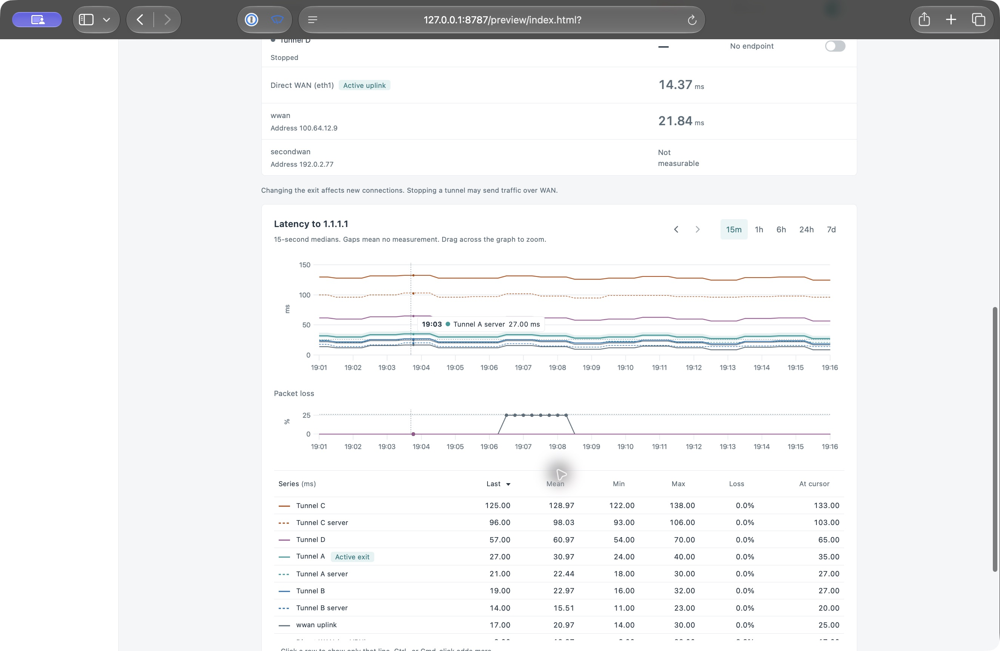
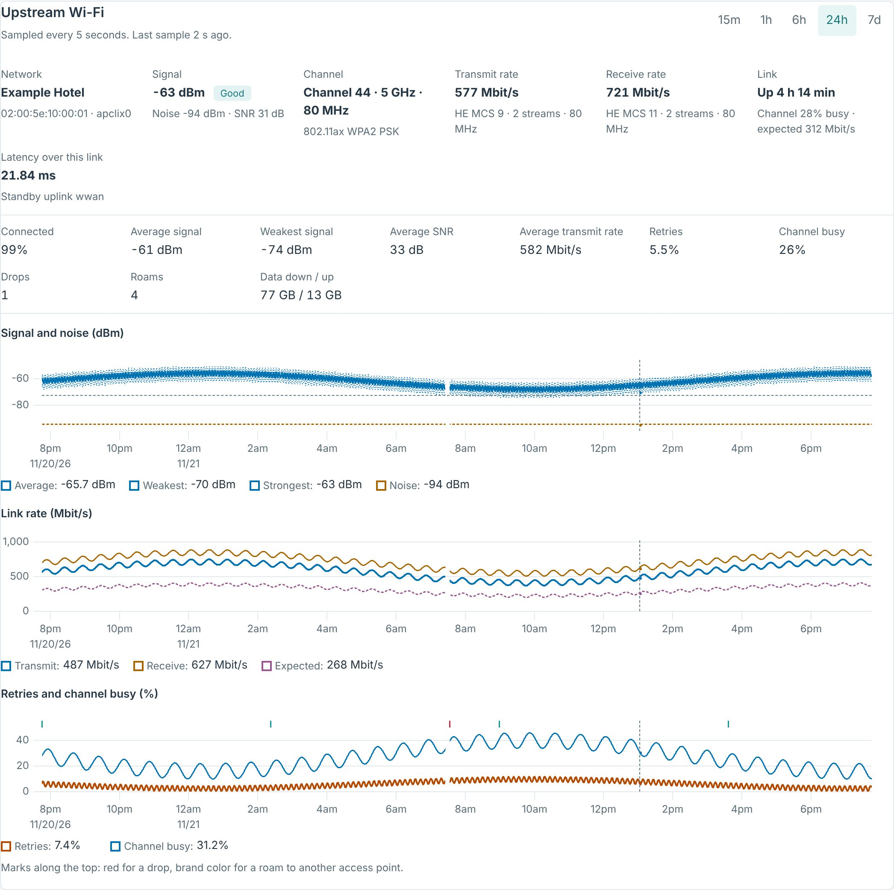

# Wayline

Wayline compares VPN tunnels on GL.iNet routers. The **VPN → Wayline** page shows latency, loss, history, and exit addresses. It provides native tunnel Start and Stop controls and manual exit selection. It also records the quality of the upstream Wi-Fi link when the router joins a network as a repeater.

Wayline is experimental. This README describes **0.1.0-alpha.24**, which fixes automatic updates. alpha.22 and alpha.23 added support for firmware 4.11 and its APK package manager, and kept history recording after a firmware upgrade. It includes the alpha.16 UI improvements. Install signed packages from [GitHub Releases](https://github.com/epk/wayline/releases).

The screenshots use synthetic data. They contain no live router addresses, endpoints, locations, or tunnel names.







## Features

- **Tunnel comparison.** One shared IPv4 ICMP core measures latency, loss, and path state through each selected tunnel.
- **Native exit selection.** *Use as exit* changes GL.iNet's tunnel priority. Separate switches start and stop tunnels.
- **Optional automatic switching.** Choose an explicit pool within the monitored tunnels. You can monitor four tunnels and permit automatic switching between only two.
- **Destinations.** Configure up to five IPv4 addresses or hostnames. The first destination controls exit eligibility and automatic comparison.
- **Optional WAN diagnostics.** Compare direct uplinks and WireGuard endpoints. Direct egress checks follow the WAN opt-in setting.
- **History.** Probe every 1 to 60 seconds (default 5). Recent minutes keep 15-second detail and older history is summarized for up to 30 days (default 7). View 15 minutes to 30 days. Drag to zoom, use arrow keys to move through history, and press Escape to return to now.
- **Upstream Wi-Fi.** Optional monitoring of the Wi-Fi network that the router joins as a repeater. It samples every five seconds and keeps signal, noise, SNR, link rates, retries, channel load, traffic, drops, and roams in the same history tiers as latency. It works without VPN tunnels.
- **Exit addresses.** Egress IP checks refresh every five minutes through the monitored tunnels and opted-in WAN path.
- **Signed updates.** Verify the manifest, package identity, size, and SHA-256 before installation. Automatic updates are off by default.

GL.iNet retains control of routes, DNS, tunnel lifecycle, and kill switches. Priority changes affect new connections. Stopping a tunnel can change native WAN fallback behavior.

## Requirements

- A GL.iNet router with the `aarch64_cortex-a53` package architecture, such as Beryl 7 or Brume 3.
- Firmware 4.9.0 or newer. Wayline is tested on 4.9 and 4.11 and checks native replies before it confirms a change.
- SSH access for the first installation.

An unverified native module shows a firmware notice. An unknown reply format disables tunnel controls in the page.

## Install

Run this command in an SSH session on the router:

```sh
curl -fsSL https://raw.githubusercontent.com/epk/wayline/main/install.sh | sh
```

The installer downloads the newest published release, including prereleases. It checks the signing key fingerprint, manifest signature, and package hash before installation.

To install a specific version, download `install.sh`. Run `WAYLINE_VERSION=0.1.0-alpha.24 sh install.sh`.

Create your VPN profiles in the factory dashboard first. Open **VPN → Wayline → Settings**. Choose the tunnels and destinations to monitor, then enable monitoring.

## Choose an exit

Select **Use as exit** beside a connected tunnel. Wayline preserves the other tunnels' relative order and asks the native VPN manager to change priority.

Manual selection requires equivalent native traffic rules. Automatic selection also requires recent healthy measurements. Different per-tunnel routing marks do not count as different traffic rules. Omitted native defaults match their explicit values. A disabled button identifies the failed check or differing rule field.

## Automatic switching

1. Open **Settings**.
2. Choose the tunnels to monitor.
3. Enable **Switch the exit automatically**.
4. Select at least two tunnels in **Tunnels allowed for automatic switching**.
5. Save Settings.

Automatic switching selects only healthy, connected members of that pool. It does not start stopped tunnels. It pauses when the current exit is outside the pool.

A faster exit needs at least 20% and 10 ms improvement, with a five-minute hold between latency-driven changes. Unhealthy-exit recovery needs one minute of observed unhealthy state. The scheduler checks once a minute, so detection and action can take longer than these minimum periods.

An uncertain switch stops further automatic requests until you review the native state and reset automatic switching in Settings. Older configurations without an explicit pool migrate with automatic switching off.

The monitor supports at most 90 simultaneous measurements. If a configuration needs more, the page warns, and the lowest-priority measurements are skipped; monitoring and exit controls keep working.

## Upstream Wi-Fi

Turn on **Monitor upstream Wi-Fi** in the Upstream Wi-Fi panel, or select **Upstream Wi-Fi link (repeater)** in **Settings → Also measure**. Connect the router to a Wi-Fi network in the router's **Internet → Repeater** page first.

The panel shows the current link: network, access point, channel, band and width, signal with noise and SNR, transmit and receive rates with MCS, streams and width, expected throughput, channel load, and connected time. When **Direct internet** is on, it also shows the latency measured through the repeater uplink.

History uses the same 15-second, 1-minute, 5-minute and 1-hour tiers and retention as latency. Each period keeps:

- Signal average, weakest and strongest, and average noise and SNR.
- Average transmit and receive rates, the slowest transmit rate, and the driver's expected throughput.
- Retried and failed transmissions, as a share of frames.
- Channel busy, receive and transmit airtime, as a share of time on the channel.
- Bytes sent and received through the repeater interface.
- Connected share, drops, and roams between access points of the same network.

Changes of network, access point, and channel appear in **Recent changes**. Purge history also deletes Wi-Fi history.

Wayline finds the repeater interface by its client mode, so it works with names such as `apclix0`, `sta1`, and `wlan-sta0`. It reads the router's `iwinfo` service and does not scan or change Wi-Fi settings. Drivers report different fields: a missing value shows as a dash. The closed MediaTek driver on some models reports approximate signal levels.

## Update and remove

To clear stored measurements, open **Settings → History → Purge history**. Confirm **Delete all history** to remove latency and Wi-Fi history, change events, and recovery copies from memory and flash. This action is immediate. Settings and VPN tunnels stay unchanged. New history begins with the next complete measurement bucket.

Choose **Settings → Check for update**, or run `wayline-ctl update --check`. Run `wayline-ctl update` to install an available signed update.

Optional automatic updates check daily and include alpha and beta releases. Keep them off when you need to control the maintenance window.

A firmware upgrade removes installed packages, including Wayline. When you keep settings during the upgrade, Wayline settings and history are kept. Run the install command again after the upgrade.

Remove Wayline with:

```sh
opkg remove wayline
```

On firmware 4.11 and newer, use:

```sh
apk del wayline
```

## Troubleshooting

- Run `wayline-ctl help` for maintenance commands.
- Run `wayline-ctl doctor` to inspect firmware support, settings, tunnels, upstream Wi-Fi, and monitor state. Redact addresses, endpoints, locations, and names before sharing its output.
- Read the tunnel's eligibility reason when **Use as exit** is disabled. Check actual traffic rules in the native dashboard.
- Sign in again if the page reports an expired session. Wayline requires a root administrator session.

## Development

Use macOS or Linux on ARM64 with [Nix](https://nixos.org/download). Enter the pinned environment:

```sh
nix run -f nix/bootstrap.nix devenv -- shell
```

- `wayline-deps` fetches locked dependencies and bootstraps xtask on the first run.
- `cargo xtask check` runs formatting, strict Clippy, critical unit checks, and frontend and integration linters.
- `cargo xtask lint` runs formatting, strict Clippy, and frontend and integration linters.
- `cargo xtask test` runs the existing critical unit checks.
- `cargo xtask build` builds the ARM64 binaries and UI bundle.
- `cargo xtask package [version]` creates the IPK in `dist/`.
- `cargo xtask preview` serves the UI with synthetic data at http://127.0.0.1:8787/preview/index.html after `pnpm --dir ui build`. Add `?wifi=off`, `?wifi=disconnected`, `?wifi=none`, `?telemetry=off`, `?compat=monitoring`, `?fail=1` or `?transport=rpc` to preview other states.

The page is React 19 with UI SDK components in TypeScript under `ui/src`. rolldown bundles it, lightningcss minifies the CSS, oxlint and oxfmt lint and format it, `tsc` type-checks it, and `node --test` runs the unit tests in `ui/test`. `pnpm --dir ui build` writes:

- `ui/dist/gl-sdk4-ui-wayline.common.js`: the small loader GL.iNet loads from `/views/`. It holds the Vue-shaped shim, the zstd decoder and the chunk manifest.
- `ui/views/wayline/<name>-<hash>.js.zst` and `.js`: the content-hashed page chunks, served from `/views/wayline/`. The loader fetches the zstd copy and falls back to the plain copy when the page blocks `blob:` scripts.
- `ui/dist/size-report.json`: first-load and total sizes. The build fails over the first-load or total budget.
- `cargo xtask lab` runs the isolated closed-box checks.

CI uses separate lint, build, and test jobs on native ARM64 runners. Tests use the binaries and package from the build job. A version change on `main` publishes those same artifacts after all checks pass. Other branches do not publish releases.

The macOS lab uses a minimal Colima VM with network namespaces and WireGuard interfaces. It starts no containers. Keep fault injection, tunnel changes, and package installation off routers that provide your working Internet connection.

A complete physical-router acceptance run remains necessary before a stable release. Resource observations and unfinished work are maintained in Notion.

## License

MIT. See [LICENSE](LICENSE). Third-party licenses ship inside the package.
