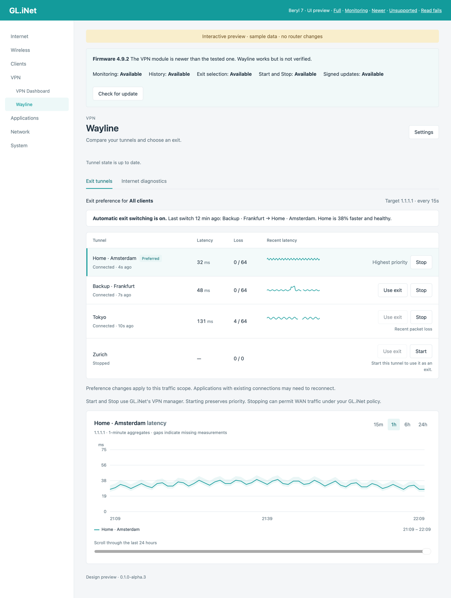
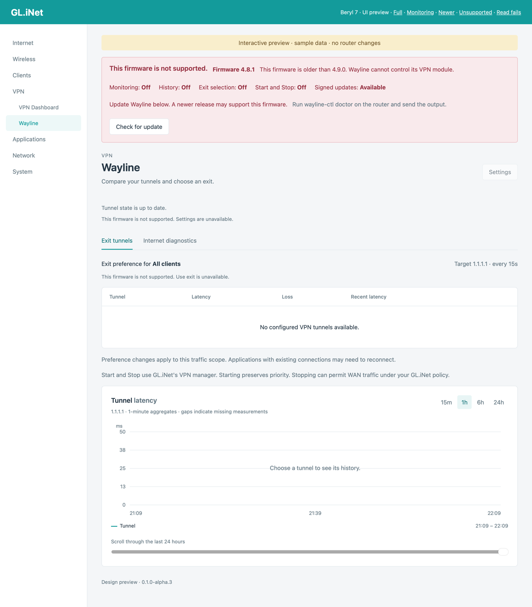
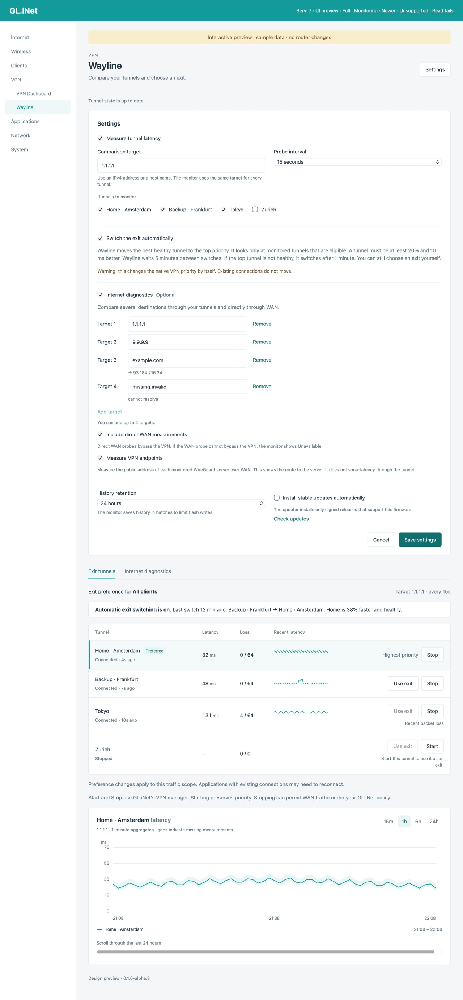

# Wayline

Wayline compares VPN latency in the GL.iNet admin UI. It adds a **VPN → Wayline** page to your router. The page shows how fast each of your VPN tunnels is right now, lets you start or stop a tunnel, and lets you choose which tunnel is your active exit.

> **Experimental alpha.** The first package targets the GL.iNet Beryl 7 (GL-MT3600BE) on firmware 4.9.0 and newer, with the `aarch64_cortex-a53` architecture. Wayline is checked in an isolated ARM64 WireGuard lab and has run on a Beryl 7. A full physical acceptance run is still open. See [Status](#status).


## What it does

- **Compares tunnels.** Wayline sends small ICMP probes through each active VPN tunnel to a shared destination and shows recent latency, loss, and path state for up to eight tunnels.
- **Chooses your exit.** *Use exit* moves a healthy tunnel to the top native priority. Wayline uses GL.iNet's own priority API. It never edits routes, DNS, marks, or kill switches.
- **Starts and stops tunnels.** *Start* and *Stop* call GL.iNet's native VPN manager. Tunnels stay visible while they are stopped or offline.
- **Switches exits by itself (optional).** When you turn it on, Wayline moves a clearly better tunnel to the top, or moves away from an unhealthy exit. It is off by default. See [Automatic exit switching](#automatic-exit-switching).
- **Shows history.** Graphs cover 15 minutes, one hour, six hours, and 24 hours, with median lines, minimum-to-maximum bands, and gaps. Optional persistent history keeps 24 hours in a database of at most 8 MiB. You can read stored history while a tunnel is stopped.
- **Checks other destinations (optional).** Add up to four targets. A target is an IPv4 address or a host name. Wayline can measure them through every tunnel and directly through WAN. It can also measure the public address of each WireGuard server over WAN.
- **Updates itself safely.** The page checks GitHub Releases, verifies a signed manifest, and installs a signed package. Updates work on every firmware, including firmware that Wayline does not yet support.


## Requirements

| Item | Requirement |
| --- | --- |
| Router | GL.iNet router with the `aarch64_cortex-a53` package architecture. Tested on the Beryl 7 (GL-MT3600BE). |
| Firmware | **4.9.0 or newer.** |
| Access | SSH to the router, to install. Root administrator session in the admin UI, to use the page. |
| Tools on the router | `curl`, `usign`, `opkg`, `sha256sum`. GL.iNet firmware includes them. |

### Firmware compatibility

Wayline needs firmware 4.9.0 or newer and works on newer firmware without a new release. GL.iNet may change its native VPN module in a later firmware, so Wayline checks the format of every native reply and turns the controls off when the format differs.

| Situation | What you get |
| --- | --- |
| Firmware 4.9.0 or newer, tested VPN module | Everything. |
| Firmware newer than the tested one | Everything, with a note on the page. Wayline stops a change if a native reply is not what it expects. |
| Native reply format is unknown | Monitoring, history, settings, and updates. Exit selection, Start and Stop, and automatic switching are off. The page says why. |
| Firmware older than 4.9.0, or no native VPN module | The page explains why it is unsupported and lists what works. **Signed updates stay available**, so a newer release can add support. |

The page is never empty. If the page cannot read the router, it shows the error, a *Retry* button, and the command to run for details.

| Firmware newer than tested | Unsupported firmware |
| --- | --- |
|  |  |

## Install

Run this one line on the router, in an SSH session:

```sh
V=0.1.0-alpha.3; P=wayline_${V}_aarch64_cortex-a53.ipk; B=https://github.com/epk/wayline/releases/download/v$V; cd /tmp && curl -fsSL --fail-early --remote-name-all "$B/release.pub" "$B/manifest.json" "$B/manifest.json.sig" "$B/$P" && [ "$(usign -F -p release.pub)" = e75bc29163d35266 ] && usign -V -p release.pub -m manifest.json -x manifest.json.sig && grep -q "$(sha256sum $P | cut -d' ' -f1)" manifest.json && opkg update && opkg install $P
```

The line downloads the package and its signed manifest from the GitHub release. It checks three things before it installs:

1. The signing key fingerprint is `e75bc29163d35266`.
2. The manifest signature is valid.
3. The package SHA-256 matches the signed manifest.

It stops at the first failure and installs nothing. The fingerprint comes from this file. Compare it with this repository through an independent connection if you want to be sure.

Then:

1. Reload the admin UI.
2. Open **VPN → Wayline → Settings**.
3. Select the tunnels to monitor.
4. Turn monitoring on.



Create your tunnels and assign VPN profiles in the factory **VPN** page first. Wayline does not create tunnels. Monitoring starts off.

Installation uses SSH because the factory plugin catalog does not list this package. Do not install a Cortex-A53 package on another architecture.

### Update

Open **VPN → Wayline → Settings** and choose *Check for update*, or turn on automatic updates. Automatic updates are off by default, check at most once a day, and install stable releases only. Alpha releases need a manual install with the line above.

Every update checks the signed manifest, the package identity and architecture, the size, and the SHA-256 before installation. An update cannot promise recovery from power loss.

### Remove

```sh
opkg remove wayline
```

Removal stops Wayline and deletes its startup and scheduler entries. The package manager may keep your settings and history. Wayline does not restore an earlier native tunnel order.

## Using Wayline

### Choose an exit

Select a tunnel and choose **Use exit**. Wayline moves that tunnel to the highest native priority and keeps the order of all others. It acts only when:

- the native traffic rules of the tunnels match,
- every enabled tunnel in the group is connected, and
- the chosen tunnel has recent healthy measurements with no loss.

Priority decides which traffic rule applies first. It does not move existing connections, and it does not change guest networks or split rules. Check **All Other Traffic** in the native VPN dashboard before you stop your current exit, because stopping a tunnel can let traffic use WAN under your GL.iNet policy. The [GL.iNet VPN dashboard guide](https://docs.gl-inet.com/router/en/4/interface_guide/vpn_dashboard/) explains priority and kill switches.

### Start and Stop

*Start* enables a tunnel and *Stop* disables it. Neither changes priority. Start needs an assigned profile. If a request fails or its result is unclear, Wayline reports the outcome as unknown and does not retry.

### Automatic exit switching

Turn it on in **Settings**. Each minute Wayline checks the current top tunnel. It switches in two cases:

- The current exit has been unhealthy, and at least 60 seconds have passed since the last change. Wayline moves the fastest healthy tunnel to the top.
- A healthy tunnel is at least **20% and 10 ms faster** than the current exit, and at least 5 minutes have passed since the last change.

A manual selection starts the same 5-minute wait. Wayline does nothing when the current top tunnel is stopped or not monitored. It uses the same checks as *Use exit*. The page shows the last automatic change.

### Targets, host names, and server addresses

The primary target is what every tunnel is compared on. With **Internet diagnostics** on, up to four more targets are measured through every tunnel. With **Direct WAN checks** on, they are also measured over WAN without the VPN. Host names resolve through the router's resolver every five minutes, and the history of a host name stays in one series when its address changes. With **Server endpoint checks** on, Wayline also pings each monitored WireGuard server's public address over WAN. That result is the route to the server, not latency through the tunnel.

Direct WAN checks need their own consent in Settings, and the route must already be allowed by your policy. Wayline never adds a bypass rule.

## Troubleshooting

Run this on the router and send the output when you report a problem:

```sh
wayline-ctl doctor
```

It prints the firmware version and support level, the installed files and their sizes, your settings, the tunnel inventory, the native VPN reply, and the monitor state. It exits with an error code when it finds a problem.

| Symptom | What to check |
| --- | --- |
| The page says the firmware is unsupported | Read the reason on the page. Update Wayline from the same panel. A newer release may support your firmware. |
| Controls are off and the page names an unknown reply format | Monitoring still works. Update Wayline, and open an issue with the `wayline-ctl doctor` output. |
| *Wayline is unavailable* with an error | You may be signed out, or the session may not be the root administrator. Reload and sign in again. |
| The monitor does not run | `wayline-ctl doctor` shows the service state. Monitoring is off until you turn it on in Settings. |

## How it works

Wayline separates a small resident monitor from infrequent control work.

| Part | Role |
| --- | --- |
| `waylined` (`monitor/`) | One thread, Monoio with the legacy epoll driver. It checks each route, sends ICMP only through the intended interface, keeps 64 recent samples per series, and serves a read-only status socket. It cannot change routes. |
| `wayline-ctl` (`control/`) | Runs for UI requests, interface events, boot, and a one-minute scheduler. It reads native discovery, applies settings, reconciles the monitor service, writes history, checks updates, and decides automatic switches. |
| Lua RPC bridge | Requires a root administrator session and exposes seven fixed operations. It never builds shell commands. |
| Vue component | Shows state, graphs, settings, and exit controls. It is not a security boundary. Rust validates every request. |

Safety rules that the code follows:

- GL.iNet keeps ownership of routes, tunnel lifecycle, DNS, marks, and kill switches.
- A probe goes out only if the kernel route lookup returns the intended interface, with the bound interface index, source address, and mark. There is no unbound fallback.
- Settings use a private temporary file and an atomic rename. Expected revisions reject stale UI writes.
- Exit changes check the revision before and the result after. They never retry blindly.
- CPU, memory, file descriptors, response sizes, and storage are bounded.

The monitor and the control helper share one wire format, defined in `protocol/`, so a field that changes in one fails to compile in the other.

## Development

Development runs on macOS ARM64 or Linux ARM64 with [Nix](https://nixos.org/download). The environment pins Rust, Node, pnpm, and every tool the checks use.

```sh
nix run -f nix/bootstrap.nix devenv -- shell
```

Run these commands inside that shell:

| Command | What it does |
| --- | --- |
| `cargo xtask deps` | Fetch Cargo and pnpm dependencies. |
| `cargo xtask check` | Format and Clippy (all, pedantic, nursery), the control-helper unit checks, Lua, shell, Nix, and Actions linters, UI lint and format, and the no-comments rule. |
| `cargo xtask build` | Cross-build the ARM64 binaries and the UI bundle. |
| `cargo xtask package [version]` | Build the signed-manifest-ready IPK in `dist/`. |
| `cargo xtask preview` | Serve the UI with sample data at <http://127.0.0.1:8787/preview/index.html>. |
| `cargo xtask lab` | Run the closed-box lab (see below). |
| `cargo xtask format` | Format Rust, Lua, shell, Nix, and the UI. |

The preview labels all values as sample data. Add `?compat=monitoring`, `?compat=newer`, `?compat=unsupported`, or `?fail=1` to see the compatibility and error states.

### Layout

| Path | Contents |
| --- | --- |
| `monitor/` | The `waylined` monitor. |
| `control/` | The `wayline-ctl` helper: `api`, `service`, `router`, `native`, `auto`, `resolve`, `history`, `update`, `settings`, `doctor`. |
| `protocol/` | Types that the monitor and the helper share. |
| `support/` | Bounded process, file, and digest helpers. |
| `xtask/` | Build, check, package, release, preview, and lab tools. |
| `ui/` | The Vue 2 component and the preview. |
| `package/` | Files installed on the router: init, hotplug, the Lua RPC bridge and validator, the menu entry, the public signing key. |
| `nix/`, `devenv.*` | The pinned development environment. |

### Tests

Wayline has no broad unit suite by design. Closed-box checks come first, and a few unit checks cover decision logic that the lab cannot reach: firmware policy, automatic exit decisions, target parsing, monitor configuration, and history binning. `cargo xtask check` runs them.

`cargo xtask lab` starts a dedicated minimal [Colima](https://github.com/abiosoft/colima) VM on macOS and stops it afterwards. It builds nothing in the VM and creates no containers. Inside, it uses network namespaces and real WireGuard interfaces to inject delay, total loss, blackhole routes, wrong exits, protocol blocks, and interface failures. It also checks crash recovery, the maximum timeout schedule, and a package install and removal against the native firmware's own `opkg`, `ubus`, UCI, session service, and HTTP dispatcher. The native firmware checks need an extracted firmware root, which this repository does not redistribute.

Project rules: Rust for the core and the tools, no code comments, no authored Python or host shell scripts, reuse upstream crates and OpenWrt tools before writing replacements, and keep every resource bounded.

### Release

Release builds use Cortex-A53 instructions, full LTO, one codegen unit, size optimization, abort-on-panic, and active overflow checks.

1. Set the version in `monitor/Cargo.toml` and in the default in `xtask/src/main.rs`.
2. Push a tag named `v<version>`.
3. The release workflow runs the checks and the lab, builds the package, signs the manifest with the `RELEASE_SIGNING_KEY` secret, verifies it against `package/files/etc/wayline/release.pub`, and publishes the IPK, manifest, signature, public key, and licenses with an empty release body.

## Status

Done and checked in the lab: monitoring, exit selection, Start and Stop, history, diagnostics, signed updates, and automatic switching rules.

Still open before a stable release: a full acceptance run on a physical Beryl 7. That run covers authentication, a packet-capture check of tunnel and WAN egress, existing connections, DNS and guest networks, kill-switch behavior, a factory UI change during a request, reboot persistence, and an update on the device. The updater cannot guarantee recovery from power loss.

Not planned: IPv6 probes, Tailscale exits, a separate routing manager, and replacement firmware.

## License

MIT. See [LICENSE](LICENSE). Third-party licenses are listed in [THIRD_PARTY_NOTICES.md](THIRD_PARTY_NOTICES.md) and ship inside the package.
