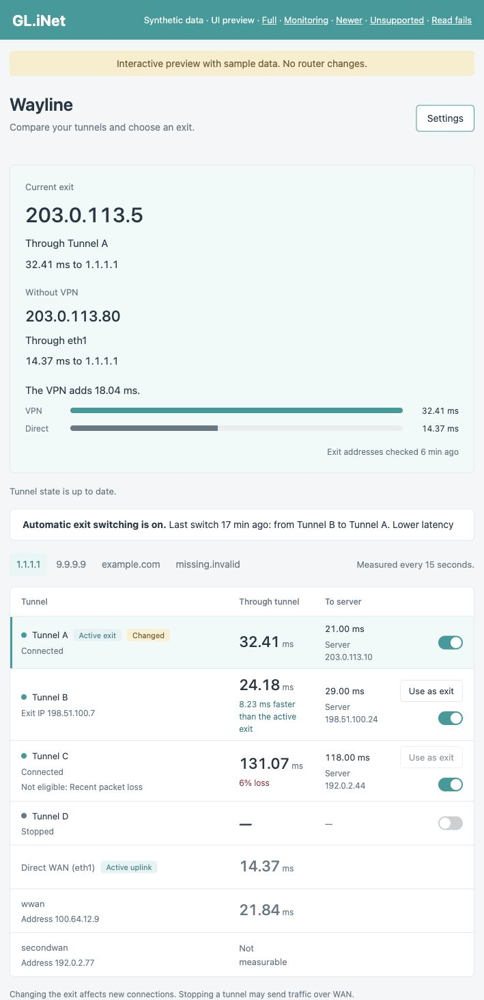
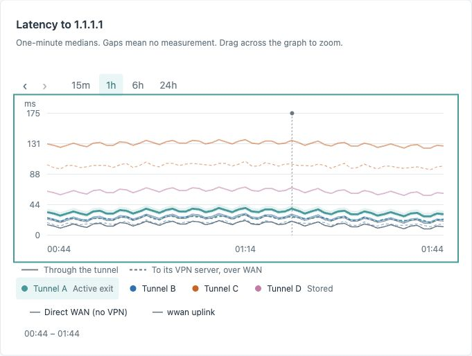

# Wayline

Wayline compares VPN tunnels on GL.iNet routers. The **VPN → Wayline** page shows latency, loss, history, and exit addresses. It provides native tunnel Start and Stop controls and manual exit selection.

Wayline is experimental. This README describes **0.1.0-alpha.9**, which includes safety fixes and a separate automatic-switching pool. Install signed packages from [GitHub Releases](https://github.com/epk/wayline/releases).

The screenshots use synthetic data. They contain no live router addresses, endpoints, locations, or tunnel names.





## Features

- **Tunnel comparison.** One shared IPv4 ICMP core measures latency, loss, and path state through each selected tunnel.
- **Native exit selection.** *Use as exit* changes GL.iNet's tunnel priority. Separate switches start and stop tunnels.
- **Optional automatic switching.** Choose an explicit pool within the monitored tunnels. You can monitor four tunnels and permit automatic switching between only two.
- **Destinations.** Configure up to five IPv4 addresses or hostnames. The first destination controls exit eligibility and automatic comparison.
- **Optional WAN diagnostics.** Compare direct uplinks and WireGuard endpoints. Direct egress checks follow the WAN opt-in setting.
- **History.** View 15 minutes to 24 hours. Drag to zoom, use arrow keys to move through history, and press Escape to return to now.
- **Exit addresses.** Egress IP checks refresh every five minutes through the monitored tunnels and opted-in WAN path.
- **Signed updates.** Verify the manifest, package identity, size, and SHA-256 before installation. Automatic updates are off by default.

GL.iNet retains control of routes, DNS, tunnel lifecycle, and kill switches. Priority changes affect new connections. Stopping a tunnel can change native WAN fallback behavior.

## Requirements

- A GL.iNet router with the `aarch64_cortex-a53` package architecture, such as Beryl 7 or Brume 3.
- Firmware 4.9.0 or newer. Mutation controls require a tested native VPN module fingerprint.
- SSH access for the first installation.

Unknown native modules permit monitoring and signed updates. Exit selection, automatic switching, and Start and Stop remain disabled until the module is verified.

## Install

Run this command in an SSH session on the router:

```sh
curl -fsSL https://raw.githubusercontent.com/epk/wayline/main/install.sh | sh
```

The installer downloads the newest published release, including prereleases. It checks the signing key fingerprint, manifest signature, and package hash before installation.

To install a specific version, download `install.sh`. Run `WAYLINE_VERSION=0.1.0-alpha.9 sh install.sh`.

Create your VPN profiles in the factory dashboard first. Open **VPN → Wayline → Settings**. Choose the tunnels and destinations to monitor, then enable monitoring.

## Choose an exit

Select **Use as exit** beside a healthy tunnel. Wayline preserves the other tunnels' relative order and asks the native VPN manager to change priority.

Eligible tunnels need recent successful measurements without loss and equivalent native traffic rules. Different per-tunnel routing marks do not count as different traffic rules. A disabled button shows the specific failed check.

## Automatic switching

1. Open **Settings**.
2. Choose the tunnels to monitor.
3. Enable **Switch the exit automatically**.
4. Select at least two tunnels in **Tunnels allowed for automatic switching**.
5. Save Settings.

Automatic switching selects only healthy, connected members of that pool. It does not start stopped tunnels. It pauses when the current exit is outside the pool.

A faster exit needs at least 20% and 10 ms improvement, with a five-minute hold between latency-driven changes. Unhealthy-exit recovery needs one minute of observed unhealthy state. The scheduler checks once a minute, so detection and action can take longer than these minimum periods.

An uncertain switch stops further automatic requests until you review the native state and reset automatic switching in Settings. Older configurations without an explicit pool migrate with automatic switching off.

The monitor supports at most 90 simultaneous measurements. If a configuration needs more, the page warns, and the lowest-priority measurements are skipped; monitoring and exit controls keep working.

## Update and remove

Choose **Settings → Check for update**, or run `wayline-ctl update --check`. Run `wayline-ctl update` to install an available signed update.

Optional automatic updates check daily and include alpha and beta releases. Keep them off when you need to control the maintenance window.

Remove Wayline with:

```sh
opkg remove wayline
```

## Troubleshooting

- Run `wayline-ctl help` for maintenance commands.
- Run `wayline-ctl doctor` to inspect firmware support, settings, tunnels, and monitor state. Redact addresses, endpoints, locations, and names before sharing its output.
- Read the tunnel's eligibility reason when **Use as exit** is disabled. Check actual traffic rules in the native dashboard.
- Sign in again if the page reports an expired session. Wayline requires a root administrator session.

## Development

Use macOS or Linux on ARM64 with [Nix](https://nixos.org/download). Enter the pinned environment:

```sh
nix run -f nix/bootstrap.nix devenv -- shell
```

- `cargo xtask deps` fetches locked dependencies.
- `cargo xtask check` runs formatting, strict Clippy, critical unit checks, and frontend and integration linters.
- `cargo xtask build` builds the ARM64 binaries and UI bundle.
- `cargo xtask package [version]` creates the IPK in `dist/`.
- `cargo xtask preview` serves the UI with synthetic data.
- `cargo xtask lab` runs the isolated closed-box checks.

The macOS lab uses a minimal Colima VM with network namespaces and WireGuard interfaces. It starts no containers. Keep fault injection, tunnel changes, and package installation off routers that provide your working Internet connection.

A complete physical-router acceptance run remains necessary before a stable release. Resource observations and unfinished work are maintained in Notion.

## License

MIT. See [LICENSE](LICENSE). Third-party licenses ship inside the package.
